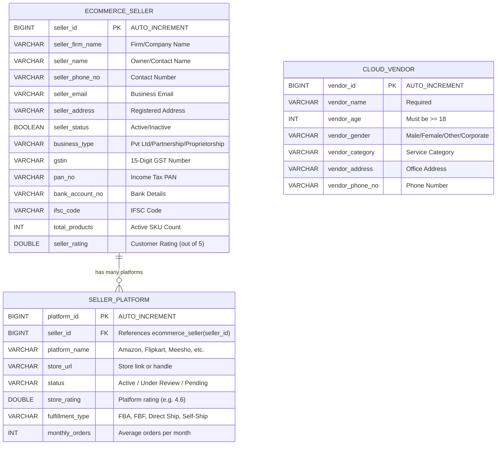
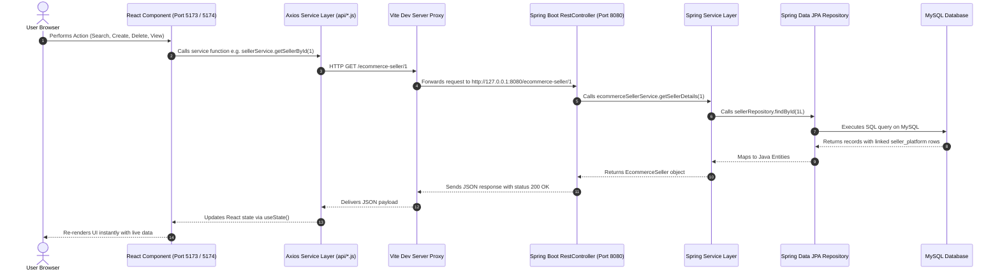

# 🛍️ Fullstack Cloud Vendor & E-Commerce Seller Management System

A multi-client fullstack enterprise application built with a **Spring Boot 3.4 REST API Backend (Port 8080)** powering **two independent React 18 + Vite Frontends**:
1. **Cloud Vendor Portal** (Port 5173) — Dedicated to Cloud Infrastructure & Vendor CRUD operations.
2. **E-Commerce Seller Portal** (Port 5174) — Dedicated to Multi-Marketplace Sellers, Tabbed Detail Profiles, and Relational Selling Platform integrations.

---

## 🏗️ System Architecture

```text
                                  ┌─────────────────────────────────────────────────┐
                                  │           MySQL Database: `rest_demo`           │
                                  │   ├── cloud_vendor                              │
                                  │   ├── ecommerce_seller                          │
                                  │   └── seller_platform (FK -> ecommerce_seller)  │
                                  └────────────────────────▲────────────────────────┘
                                                           │ Spring Data JPA / Hibernate
                                  ┌────────────────────────▼────────────────────────┐
                                  │      Spring Boot REST Backend (Port 8080)       │
                                  │   ├── /cloudvendor                              │
                                  │   └── /ecommerce-seller                         │
                                  └────────────────────────┬────────────────────────┘
                                                           │ HTTP REST / JSON
                              ┌────────────────────────────┴────────────────────────────┐
                              ▼                                                         ▼
       ┌──────────────────────────────────────────────┐          ┌──────────────────────────────────────────────┐
       │   Frontend 1: Vendors Portal (Port 5173)     │          │    Frontend 2: Sellers Portal (Port 5174)    │
       │   - Dedicated Cloud Vendors CRUD             │          │    - Dedicated E-commerce Sellers CRUD       │
       │   - Live Search & Filtering                  │          │    - Tabbed Detail Profiles (5 Tabs)         │
       │   - Modular Component Architecture           │          │    - Relational Platform Management          │
       └──────────────────────────────────────────────┘          └──────────────────────────────────────────────┘
```

---

## 📁 Full Project Directory Structure

```text
SpringBoot_Project/
├── pom.xml                                  <-- Maven Configuration (Spring Boot 3.4.12, JPA, MySQL, H2)
├── README.md                                <-- Project Documentation
├── .gitignore                               <-- Git rules (ignores node_modules/ & build outputs)
│
├── src/main/java/com/abhimishra17/rest_demo/
│   ├── RestDemoApplication.java             <-- Spring Boot Application Main Entry
│   │
│   ├── model/                               <-- JPA Entities (Database Tables)
│   │   ├── CloudVendor.java                 (Table: cloud_vendor)
│   │   ├── EcommerceSeller.java             (Table: ecommerce_seller)
│   │   └── SellerPlatform.java              (Table: seller_platform, @ManyToOne -> EcommerceSeller)
│   │
│   ├── repository/                          <-- Spring Data JPA Repositories (SQL operations)
│   │   ├── CloudVendorRepository.java
│   │   ├── EcommerceSellerRepository.java
│   │   └── SellerPlatformRepository.java
│   │
│   ├── service/                             <-- Business Logic & Validation
│   │   ├── CloudVendorService.java
│   │   └── EcommerceSellerService.java
│   │
│   └── controller/                          <-- REST Endpoints (HTTP request handling)
│       ├── CloudAPIService.java             (Handles /cloudvendor)
│       └── EcommerceSellerController.java   (Handles /ecommerce-seller)
│
├── frontend-vendors/                        <-- React Frontend #1: Cloud Vendors (Port 5173)
│   ├── package.json
│   ├── vite.config.js                       (Configured on Port 5173, reverse proxy to /cloudvendor)
│   ├── index.html
│   └── src/
│       ├── main.jsx                         (Application Mount)
│       ├── App.jsx                          (Clean View Coordinator)
│       ├── index.css                        (Blue Theme Design System)
│       ├── api/
│       │   └── vendorService.js             (Isolated Axios REST client)
│       └── components/
│           ├── VendorList.jsx               (Search, Filter, and Table View)
│           └── VendorForm.jsx               (Create & Update Modal Form)
│
└── frontend-sellers/                        <-- React Frontend #2: E-Commerce Sellers (Port 5174)
    ├── package.json
    ├── vite.config.js                       (Configured on Port 5174, reverse proxy to /ecommerce-seller)
    ├── index.html
    └── src/
        ├── main.jsx                         (Application Mount)
        ├── App.jsx                          (Clean View Coordinator)
        ├── index.css                        (Emerald Green Theme Design System)
        ├── api/
        │   └── sellerService.js             (Isolated Axios REST client for Sellers & Platforms)
        └── components/
            ├── SellerList.jsx               (Search, Status Filter, and Table View)
            ├── SellerForm.jsx               (Create & Update Seller Form)
            └── detail/                      (Modular 5-Tab Detail Page Components)
                ├── SellerDetail.jsx         (Header & Tabs Navigation Coordinator)
                ├── GeneralInfoTab.jsx       (Tab 1: Firm Name, Owner Name, Contacts)
                ├── PlatformsTab.jsx         (Tab 2: Marketplace Integrations Table + Add Form)
                ├── CatalogTab.jsx           (Tab 3: Product SKUs & Stock Availability)
                ├── ComplianceTab.jsx        (Tab 4: GSTIN, PAN, Bank & KYC Verification)
                └── MetricsTab.jsx           (Tab 5: Ratings, On-Time Dispatch SLA, Return Rates)
```

---

## 🗄️ Database Architecture & Table Structure (MySQL)

The application uses MySQL database `rest_demo` on `localhost:3306`. Hibernate automatically synchronizes tables using `spring.jpa.hibernate.ddl-auto=update`.

### Entity-Relationship Diagram (ERD)



---

### Detailed Table Schemas

#### 1. Table: `cloud_vendor`
| Column Name | SQL Type | Constraints | Description |
|---|---|---|---|
| `vendor_id` | `BIGINT` | `PRIMARY KEY`, `AUTO_INCREMENT` | Unique identifier for each cloud vendor |
| `vendor_name` | `VARCHAR(255)` | `NOT NULL` | Name of the vendor / organization |
| `vendor_age` | `INT` | `CHECK (vendor_age >= 18)` | Age of the registered vendor |
| `vendor_gender` | `VARCHAR(255)` | `NOT NULL` | Gender or corporate entity identifier |
| `vendor_category`| `VARCHAR(255)` | `NOT NULL` | Service domain (e.g. Storage, DevOps, DBaaS) |
| `vendor_address` | `VARCHAR(255)` | `NOT NULL` | Physical headquarters / office address |
| `vendor_phone_no`| `VARCHAR(255)` | `NOT NULL` | Official contact telephone number |

#### 2. Table: `ecommerce_seller`
| Column Name | SQL Type | Constraints | Description |
|---|---|---|---|
| `seller_id` | `BIGINT` | `PRIMARY KEY`, `AUTO_INCREMENT` | Unique identifier for each e-commerce seller |
| `seller_firm_name` | `VARCHAR(255)` | `NOT NULL` | Registered firm / business name |
| `seller_name` | `VARCHAR(255)` | `NOT NULL` | Primary owner / contact person |
| `seller_phone_no` | `VARCHAR(255)` | `NOT NULL` | Business phone contact |
| `seller_email` | `VARCHAR(255)` | `NOT NULL` | Official business communication email |
| `seller_address` | `VARCHAR(255)` | `NOT NULL` | Registered office location |
| `seller_status` | `BOOLEAN` | `DEFAULT TRUE` | Operational status (`true` = Active, `false` = Inactive) |
| `business_type` | `VARCHAR(255)` | `NULLABLE` | Entity classification (Private Limited, Partnership) |
| `gstin` | `VARCHAR(255)` | `NULLABLE` | 15-digit GST identification number |
| `pan_no` | `VARCHAR(255)` | `NULLABLE` | Permanent Account Number |
| `bank_account_no` | `VARCHAR(255)` | `NULLABLE` | Settlement bank account details |
| `ifsc_code` | `VARCHAR(255)` | `NULLABLE` | Bank branch IFSC code |
| `total_products` | `INT` | `NULLABLE` | Total active products / SKUs listed |
| `seller_rating` | `DOUBLE` | `NULLABLE` | Average seller score (e.g. 4.6 / 5.0) |

#### 3. Table: `seller_platform`
| Column Name | SQL Type | Constraints | Description |
|---|---|---|---|
| `platform_id` | `BIGINT` | `PRIMARY KEY`, `AUTO_INCREMENT` | Unique identifier for each platform integration |
| `seller_id` | `BIGINT` | `FOREIGN KEY` references `ecommerce_seller(seller_id)` | Linked seller parent record |
| `platform_name` | `VARCHAR(255)` | `NOT NULL` | Channel name (Amazon India, Flipkart, Meesho, Myntra, Ajio, Shopify) |
| `store_url` | `VARCHAR(255)` | `NOT NULL` | Store link or seller storefront handle |
| `status` | `VARCHAR(255)` | `NOT NULL` | Channel status (`Active`, `Under Review`, `Pending`, `Inactive`) |
| `store_rating` | `DOUBLE` | `NULLABLE` | Customer rating on that specific marketplace |
| `fulfillment_type`| `VARCHAR(255)` | `NULLABLE` | Delivery method (FBA, Flipkart Assured, Direct Ship) |
| `monthly_orders` | `INT` | `DEFAULT 0` | Average monthly volume processed on this platform |

---

## ⚡ How the API Communication Works



---

## 🔌 Complete REST API Reference (12 Total Endpoints)

The backend provides **12 REST API endpoints**:

| # | Group | Method | Endpoint URL | Description |
|---|---|---|---|---|
| **1** | Cloud Vendors | `GET` | `/cloudvendor` | Fetch all registered cloud vendors |
| **2** | Cloud Vendors | `GET` | `/cloudvendor/{vendorId}` | Fetch a single cloud vendor by ID |
| **3** | Cloud Vendors | `POST` | `/cloudvendor` | Create a new cloud vendor (validates age $\ge 18$, mandatory fields) |
| **4** | Cloud Vendors | `PUT` | `/cloudvendor/{vendorId}` | Update an existing cloud vendor's information |
| **5** | Cloud Vendors | `DELETE` | `/cloudvendor/{vendorId}` | Permanently delete a cloud vendor by ID |
| **6** | E-Commerce Sellers | `GET` | `/ecommerce-seller` | Fetch all e-commerce sellers |
| **7** | E-Commerce Sellers | `GET` | `/ecommerce-seller/{sellerId}` | Fetch full seller profile **including all relational platforms** |
| **8** | E-Commerce Sellers | `POST` | `/ecommerce-seller` | Register a new e-commerce seller |
| **9** | E-Commerce Sellers | `PUT` | `/ecommerce-seller/{sellerId}` | Update an existing e-commerce seller's details |
| **10** | E-Commerce Sellers | `DELETE` | `/ecommerce-seller/{sellerId}` | Delete an e-commerce seller (cascades deletion to platforms) |
| **11** | Seller Platforms | `POST` | `/ecommerce-seller/{sellerId}/platforms` | Connect a new selling marketplace (Amazon, Flipkart, etc.) to a seller |
| **12** | Seller Platforms | `DELETE` | `/ecommerce-seller/{sellerId}/platforms/{platformId}` | Remove a marketplace integration from a seller |

---

### Detailed API Specifications & Examples

#### 1. `GET /cloudvendor`
- **Description**: Returns all cloud vendors in the system.
- **Response `200 OK`**:
```json
[
  {
    "vendorId": 1,
    "vendorName": "Flipkart Cloud Services",
    "vendorAge": 19,
    "vendorGender": "Male",
    "vendorCategory": "Cloud Services",
    "vendorAddress": "Delhi, India",
    "vendorPhoneNo": "9876543210"
  }
]
```

---

#### 2. `POST /cloudvendor`
- **Description**: Registers a new vendor. Requires `vendorAge >= 18` and non-empty strings.
- **Request Body**:
```json
{
  "vendorName": "Amazon Web Services",
  "vendorAge": 28,
  "vendorGender": "Corporate",
  "vendorCategory": "Cloud Infrastructure",
  "vendorAddress": "Seattle, WA, USA",
  "vendorPhoneNo": "18005550199"
}
```
- **Response `200 OK`**: `"Cloud Vendor Created Successfully"`

---

#### 3. `GET /ecommerce-seller/{sellerId}`
- **Description**: Returns full seller details together with all associated selling platforms (**powers the Tabbed Detail Page**).
- **Response `200 OK`**:
```json
{
  "sellerId": 1,
  "sellerName": "Rahul Sharma",
  "sellerFirmName": "Sharma Electronics",
  "sellerAddress": "Delhi, India",
  "sellerPhoneNo": "9876543212",
  "sellerEmail": "rahul@sharmaelectronics.com",
  "sellerStatus": true,
  "businessType": "Private Limited",
  "gstin": "07AAACS1810Z2",
  "panNo": "AABCS1001F",
  "bankAccountNo": "HDFC Bank •••• 4111",
  "ifscCode": "HDFC0001234",
  "totalProducts": 135,
  "sellerRating": 4.5,
  "platforms": [
    {
      "platformId": 1,
      "platformName": "Amazon India",
      "storeUrl": "amazon.in/shops/sharma-electronics",
      "status": "Active",
      "storeRating": 4.6,
      "fulfillmentType": "FBA (Fulfilled by Amazon)",
      "monthlyOrders": 520
    },
    {
      "platformId": 2,
      "platformName": "Flipkart",
      "storeUrl": "flipkart.com/seller/sharma-electronics",
      "status": "Active",
      "storeRating": 4.4,
      "fulfillmentType": "Flipkart Assured (FBF)",
      "monthlyOrders": 410
    },
    {
      "platformId": 3,
      "platformName": "Meesho",
      "storeUrl": "meesho.com/supplier/1",
      "status": "Active",
      "storeRating": 4.3,
      "fulfillmentType": "Meesho Direct Ship",
      "monthlyOrders": 280
    }
  ]
}
```

---

#### 4. `POST /ecommerce-seller/{sellerId}/platforms`
- **Description**: Adds a new marketplace channel to an existing seller.
- **Request Body**:
```json
{
  "platformName": "Myntra",
  "storeUrl": "myntra.com/brand/sharma-fashion",
  "status": "Active",
  "storeRating": 4.7,
  "fulfillmentType": "Drop-Ship / Omni-Channel",
  "monthlyOrders": 180
}
```
- **Response `200 OK`**: `"Platform added successfully"`

---

#### 5. `DELETE /ecommerce-seller/{sellerId}/platforms/{platformId}`
- **Description**: Removes a marketplace integration from a seller.
- **Response `200 OK`**: `"Platform deleted successfully"`

---

## 🚀 How to Run the Applications Locally

### Prerequisites
- **Java 17 or higher**
- **Apache Maven 3.8+**
- **Node.js v18+ and npm**
- **MySQL Server 8.0+** running on `localhost:3306` with database `rest_demo`.

---

### Step 1: Start the Spring Boot Backend (Port 8080)
```bash
cd SpringBoot_Project
mvn spring-boot:run
```
Backend will start on: 👉 **`http://localhost:8080`**

---

### Step 2: Start Frontend 1 — Cloud Vendors Portal (Port 5173)
In a new terminal window:
```bash
cd SpringBoot_Project/frontend-vendors
npm install
npm run dev
```
Open your browser at: 👉 **`http://localhost:5173`**

---

### Step 3: Start Frontend 2 — E-Commerce Sellers Portal (Port 5174)
In a third terminal window:
```bash
cd SpringBoot_Project/frontend-sellers
npm install
npm run dev
```
Open your browser at: 👉 **`http://localhost:5174`**

---

## 🛡️ CORS & Reverse Proxy Configuration

To prevent browser Cross-Origin Resource Sharing (CORS) blocks:
1. **Spring Boot Controller Level**: Both `@RestController` classes include `@CrossOrigin(origins = "*")`.
2. **Vite Development Reverse Proxy**:
   - `frontend-vendors/vite.config.js` forwards `/cloudvendor` requests directly to `http://127.0.0.1:8080`.
   - `frontend-sellers/vite.config.js` forwards `/ecommerce-seller` requests directly to `http://127.0.0.1:8080`.
This allows the frontend applications to make simple relative requests (e.g. `axios.get('/ecommerce-seller')`) while avoiding any browser CORS issues.
